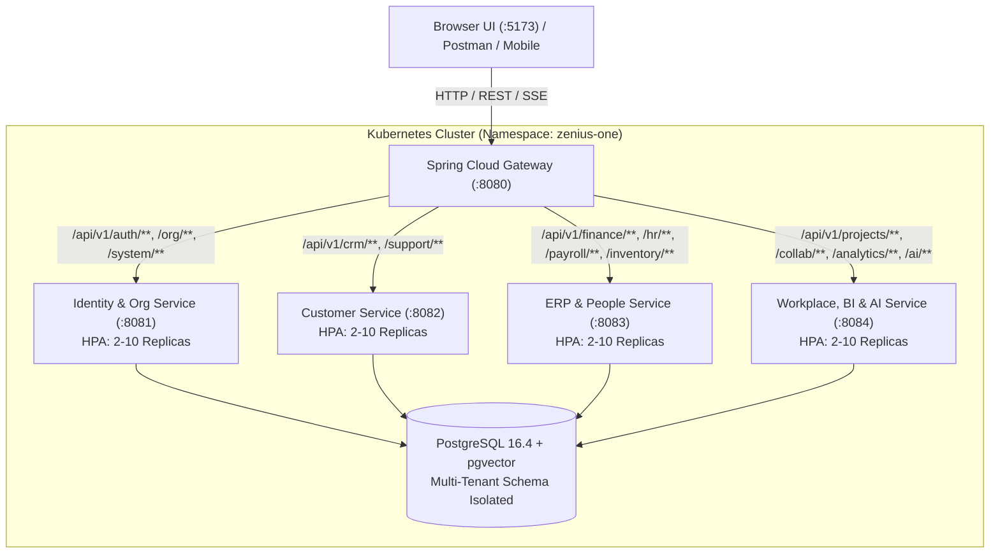

# Zenius One Enterprise OS

**Unified Multi-Tenant Enterprise Business Operating System with AI**  
*Full-stack microservices architecture inspired by the Zoho One ecosystem.*

[](file:///Users/apple/Desktop/Antigravity/Zoho/services)
[](https://spring.io/projects/spring-boot)
[](https://spring.io/projects/spring-cloud-gateway)
[](file:///Users/apple/Desktop/Antigravity/Zoho/frontend)
[](https://www.postgresql.org/)
[](file:///Users/apple/Desktop/Antigravity/Zoho/infrastructure/k8s)

---

## Table of Contents
1. [Architecture Overview](#1-architecture-overview)
2. [Microservices & Technology Stack Matrix](#2-microservices--technology-stack-matrix)
3. [API Request & Response Catalog](#3-api-request--response-catalog)
4. [Step-by-Step Guide to Run the Application](#4-step-by-step-guide-to-run-the-application)
   - [Prerequisites](#prerequisites)
   - [Option A: One-Command All-in-One Local Run (Recommended)](#option-a-one-command-all-in-one-local-run-recommended)
   - [Option B: Multi-Container Docker Compose](#option-b-multi-container-docker-compose)
   - [Option C: Kubernetes Deployment with Auto-Scaling (HPA)](#option-c-kubernetes-deployment-with-auto-scaling-hpa)
5. [Postman API Collection](#5-postman-api-collection)
6. [Automated Verification & Testing](#6-automated-verification--testing)
7. [Default Seed Credentials & Test Data](#7-default-seed-credentials--test-data)

---

## 1. Architecture Overview

Zenius One decomposes enterprise business management into specialized, independently scalable microservices routed through a unified, resilient **Spring Cloud Gateway** (`:8080`) with a responsive **React 19 / TypeScript** UI (`:5173`):



---

## 2. Microservices & Technology Stack Matrix

| Service | Port | Technology Stack | Core Business Capabilities | Gateway Route Path |
|---|---|---|---|---|
| **`gateway-service`** | `8080` | Spring Cloud Gateway, Netty Reactive Engine, Java 21, Actuator | Reverse proxy routing, global CORS filter, token relay, rate-limiting, and microservice discovery | `/api/v1/**` |
| **`identity-org-service`** | `8081` | Spring Boot 3.5, Spring Security, JWT (HMAC-SHA512), Flyway, PostgreSQL 16 | Multi-tenant authentication, MFA/TOTP, Org Hierarchy, Branches, Departments, RBAC Roles & Permissions, Audit Logging | `/api/v1/auth/**`<br/>`/api/v1/org/**`<br/>`/api/v1/system/**` |
| **`customer-service`** | `8082` | Spring Boot 3.5, Spring Data JPA, Hibernate, PostgreSQL 16 | CRM Lead Lifecycle, Accounts, Contacts, Opportunity Deals, Products Catalog, Quotes & 1-Click Sales Orders, Support Tickets & Knowledge Base | `/api/v1/crm/**`<br/>`/api/v1/support/**` |
| **`erp-people-service`** | `8083` | Spring Boot 3.5, Spring Data JPA, Flyway (V1-V11), PostgreSQL 16 | Double-entry Accounting, Invoices & Payments, Warehouses & Stock Transfers, HR Geo-Attendance with GPS Geofencing, Leave Management, Recruitment, Payroll Engine | `/api/v1/finance/**`<br/>`/api/v1/inventory/**`<br/>`/api/v1/hr/**`<br/>`/api/v1/recruitment/**`<br/>`/api/v1/payroll/**` |
| **`workplace-ai-service`** | `8084` | Spring Boot 3.5, Spring Data JPA, pgvector, SSE Stream Relays, PostgreSQL 16 | Projects & Kanban Boards, Task status advancement, Billable Timesheets, Webmail, Channels & Chat, Cloud Folders, Executive BI Pulse, AI Copilot | `/api/v1/projects/**`<br/>`/api/v1/collab/**`<br/>`/api/v1/docs/**`<br/>`/api/v1/analytics/**`<br/>`/api/v1/ai/**` |
| **`frontend`** | `5173` / `80` | React 19, TypeScript 5, Vite 6, Tailwind CSS, Redux Toolkit Query, Lucide Icons | Responsive enterprise UI, SSO authentication gate, digital ticking punch clock, GPS device geolocation, dynamic quote calculators, Kanban drag-less advancement | N/A (Client SPA) |

---

## 3. API Request & Response Catalog

This catalog details which backend microservice and technology stack handles each critical business API request, along with real-world request and response payloads.

### 3.1 Authentication & Session
- **Handled by:** `identity-org-service` (`:8081`) via Gateway (`:8080`)
- **Stack:** Spring Security 6, JJWT (HMAC-SHA512), BCrypt password hashing

#### `POST /api/v1/auth/login`
- **Request Headers:** `Content-Type: application/json`
- **Request Body:**
```json
{
  "email": "admin@zeniusone.local",
  "password": "Zenius@2026!"
}
```
- **Response (`200 OK`):**
```json
{
  "success": true,
  "data": {
    "mfaRequired": false,
    "session": {
      "accessToken": "eyJhbGciOiJIUzUxMiJ9...",
      "refreshToken": "pDrxwmUmwoOfB9Qf...",
      "tokenType": "Bearer",
      "user": {
        "id": "94e90cc6-b80d-44fe-b8db-314efe772d38",
        "email": "admin@zeniusone.local",
        "fullName": "Aarav Mehta",
        "jobTitle": "Chief Enterprise Architect",
        "permissions": ["hr:read", "hr:write", "crm:quote:write", "projects:write", "finance:read"]
      }
    }
  }
}
```

---

### 3.2 GPS Geo-Attendance & Office Geofencing
- **Handled by:** `erp-people-service` (`:8083`) via Gateway (`:8080`)
- **Stack:** Spring Data JPA, Hibernate, Flyway migration [V11__hr_geocheckout_and_leave_enhancements.sql](file:///Users/apple/Desktop/Antigravity/Zoho/services/shared-kernel/src/main/resources/db/migration/V11__hr_geocheckout_and_leave_enhancements.sql)

#### `POST /api/v1/hr/attendance/check-in`
- **Request Headers:** `Authorization: Bearer <token>`, `Content-Type: application/json`
- **Request Body:**
```json
{
  "employeeId": "d9533db9-be80-4716-964c-e5497ba760d4",
  "latitude": 40.7128,
  "longitude": -74.0060,
  "accuracy": 12.5,
  "source": "GPS",
  "locationLabel": "Zenius Global HQ (Office Geofence - Primary Campus)"
}
```
- **Response (`201 Created`):**
```json
{
  "success": true,
  "data": {
    "id": "6b5791d7-1153-45ff-a601-ef4a40a3c3fe",
    "employeeId": "d9533db9-be80-4716-964c-e5497ba760d4",
    "workDate": "2026-11-12",
    "checkInAt": "2026-11-12T17:28:07Z",
    "latitude": 40.7128,
    "longitude": -74.0060,
    "locationLabel": "Zenius Global HQ (Office Geofence - Primary Campus)",
    "status": "PRESENT"
  }
}
```

#### `POST /api/v1/hr/attendance/{employeeId}/check-out`
- **Request Headers:** `Authorization: Bearer <token>`, `Content-Type: application/json`
- **Request Body:**
```json
{
  "latitude": 40.7132,
  "longitude": -74.0058
}
```
- **Response (`200 OK`):**
```json
{
  "success": true,
  "data": {
    "id": "6b5791d7-1153-45ff-a601-ef4a40a3c3fe",
    "checkOutAt": "2026-11-12T22:58:07Z",
    "checkOutLatitude": 40.7132,
    "checkOutLongitude": -74.0058,
    "workedMinutes": 330,
    "status": "PRESENT"
  }
}
```

---

### 3.3 Leave Management & Decision Workflows
- **Handled by:** `erp-people-service` (`:8083`) via Gateway (`:8080`)

#### `POST /api/v1/hr/leaves` (Apply Leave)
- **Request Body:**
```json
{
  "employeeId": "d9533db9-be80-4716-964c-e5497ba760d4",
  "leaveType": "ANNUAL",
  "startDate": "2026-11-25",
  "endDate": "2026-11-27",
  "reason": "Executive leadership summit and Q4 roadmap planning"
}
```
- **Response (`200 OK`):**
```json
{
  "success": true,
  "data": {
    "id": "a136edc6-3eb3-497f-88d7-ac5cc5ae36d1",
    "employeeId": "d9533db9-be80-4716-964c-e5497ba760d4",
    "leaveType": "ANNUAL",
    "startDate": "2026-11-25",
    "endDate": "2026-11-27",
    "daysCount": 3,
    "status": "PENDING"
  }
}
```

#### `POST /api/v1/hr/leaves/{id}/decision` (Approve / Reject)
- **Request Body:**
```json
{
  "decision": "APPROVED",
  "remarks": "Approved by Chief People Officer"
}
```
- **Response (`200 OK`):**
```json
{
  "success": true,
  "data": {
    "id": "a136edc6-3eb3-497f-88d7-ac5cc5ae36d1",
    "status": "APPROVED",
    "decisionRemarks": "Approved by Chief People Officer"
  }
}
```

#### `POST /api/v1/hr/leaves/{id}/cancel` (Employee Self-Cancel)
- **Response (`200 OK`):**
```json
{
  "success": true,
  "data": {
    "id": "c75dd4c6-d245-4dcb-bc6c-a469e6369162",
    "status": "CANCELLED"
  }
}
```

---

### 3.4 Dynamic OKR Goal Progress
- **Handled by:** `erp-people-service` (`:8083`) via Gateway (`:8080`)

#### `PATCH /api/v1/hr/goals/{id}/progress`
- **Request Body:**
```json
{
  "progressPercent": 100
}
```
- **Response (`200 OK`):**
```json
{
  "success": true,
  "data": {
    "id": "63725596-9609-4d1e-b401-e955e6ee1efb",
    "title": "Q4 OKR Milestone #1",
    "progressPercent": 100,
    "reviewStatus": "COMPLETED"
  }
}
```

---

### 3.5 Sales Commercials & 1-Click Order Conversion
- **Handled by:** `customer-service` (`:8082`) via Gateway (`:8080`)

#### `POST /api/v1/crm/quotes/{id}/convert`
- **Request Headers:** `Authorization: Bearer <token>`
- **Response (`200 OK`):**
```json
{
  "success": true,
  "data": {
    "id": "e9b275a1-43ef-4b2a-899f-7f12e8b03099",
    "orderNumber": "SO-2026-0042",
    "quoteId": "quote-uuid",
    "status": "CONFIRMED",
    "grandTotal": 14754.00,
    "createdAt": "2026-11-12T17:30:00Z"
  }
}
```

---

### 3.6 Interactive Projects Kanban & Timesheets
- **Handled by:** `workplace-ai-service` (`:8084`) via Gateway (`:8080`)

#### `PATCH /api/v1/projects/tasks/{id}/status`
- **Request Body:**
```json
{
  "status": "DONE"
}
```
- **Response (`200 OK`):**
```json
{
  "success": true,
  "data": {
    "id": "task-uuid",
    "taskKey": "ZNS-104",
    "status": "DONE",
    "updatedAt": "2026-11-12T17:31:00Z"
  }
}
```

#### `POST /api/v1/projects/time-logs`
- **Request Body:**
```json
{
  "taskId": "task-uuid",
  "minutesLogged": 90,
  "billable": true,
  "notes": "Configured Kubernetes HPA autoscaling and microservices gateway routes"
}
```
- **Response (`200 OK`):**
```json
{
  "success": true,
  "data": {
    "id": "timelog-uuid",
    "minutesLogged": 90,
    "billable": true,
    "workDate": "2026-11-12"
  }
}
```

---

### 3.7 Cross-Service Real-Time Executive Pulse
- **Handled by:** `workplace-ai-service` (`:8084`) via Gateway (`:8080`)
- **Aggregates:** CRM Deals + Accounting Invoices + Support Queue + HR Roster + Sprint Tasks

#### `GET /api/v1/analytics/pulse`
- **Response (`200 OK`):**
```json
{
  "success": true,
  "data": {
    "leadCount": 200,
    "dealCount": 25,
    "pipelineValue": 2062500.0,
    "weightedForecast": 1282500.0,
    "totalInvoiced": 597375.0,
    "totalReceivable": 293525.0,
    "openTickets": 60,
    "employeeHeadcount": 60,
    "totalTasks": 60,
    "completedTasks": 15,
    "moduleBreakdown": [
      { "label": "CRM Leads", "count": 200, "amount": 0 },
      { "label": "CRM Deals", "count": 25, "amount": 2062500.0 },
      { "label": "Invoices", "count": 50, "amount": 597375.0 },
      { "label": "Support Tickets", "count": 120, "amount": 0 },
      { "label": "Employees", "count": 60, "amount": 0 },
      { "label": "Project Tasks", "count": 60, "amount": 0 }
    ]
  }
}
```

---

## 4. Step-by-Step Guide to Run the Application

### Prerequisites
Make sure your system meets the minimum requirements:
- **Java**: OpenJDK / Eclipse Temurin 21 or later (`java -version`)
- **Maven**: 3.9.0 or later (`mvn -version`)
- **Node.js**: Node 20 or 22 (`node -v`) and npm (`npm -v`)
- **Docker & Compose**: Docker Engine 24+ with Compose v2 (`docker compose version`)
- **Kubernetes CLI (for K8s deployment)**: `kubectl` with an active cluster context (Minikube, Kind, k3s, EKS, or GKE)

---

### Option A: One-Command All-in-One Local Run (Recommended)

Run the entire platform — building all 7 Maven modules, starting the 4 backend microservices (`:8081`–`:8084`), launching the Spring Cloud Gateway (`:8080`), and spinning up the React 19 / Vite UI (`:5173`) — with a single command:

```bash
./run.sh
```

#### What happens behind the scenes:
1. Installs frontend dependencies in `frontend/` if not present.
2. Packages all microservice JARs via `mvn -f services/pom.xml -q package -DskipTests`.
3. Starts `identity-org-service` on port `8081` with Flyway database migration and automatic data seeding (over 1,040 production records pre-loaded).
4. Concurrently starts domain microservices:
   - `customer-service` on port `8082`
   - `erp-people-service` on port `8083`
   - `workplace-ai-service` on port `8084`
5. Starts `gateway-service` on port `8080` and verifies reverse proxy readiness.
6. Starts the React 19 + Vite development server on `http://localhost:5173`.
7. **Sign in to access all enterprise workspaces:**
   - **URL:** [http://localhost:5173](http://localhost:5173)
   - **Email:** `admin@zeniusone.local`
   - **Password:** `Zenius@2026!`

To stop all running microservices and the frontend, press `Ctrl + C` (graceful shutdown trap will terminate all child PIDs).

---

### Option B: Multi-Container Docker Compose

To run the complete containerized stack in isolated Docker containers:

```bash
# 1. Prepare environment variables
cp .env.example .env

# 2. Build and launch all containerized microservices
./run.sh --docker
# OR directly via Docker Compose:
docker compose up --build -d
```

#### Running Containers:
- `zenius-postgres`: PostgreSQL 16 with `pgvector` extension (`:5432`)
- `identity-org-service`: Identity, Org, RBAC, System (`:8081`)
- `customer-service`: CRM, Sales Commercials, Support (`:8082`)
- `erp-people-service`: Finance, Inventory, HR & Geo-Attendance, Payroll (`:8083`)
- `workplace-ai-service`: Projects, Collab Mail/Chat, BI Analytics, AI Copilot (`:8084`)
- `gateway-service`: Spring Cloud Gateway reverse proxy (`:8080`)
- `frontend`: React 19 compiled to static distribution served by NGINX (`:80` / `:5173`)

To stop Docker containers:
```bash
docker compose down -v
```

---

### Option C: Kubernetes Deployment with Auto-Scaling (HPA)

The Kubernetes manifests in [`infrastructure/k8s/`](file:///Users/apple/Desktop/Antigravity/Zoho/infrastructure/k8s) provide a complete, production-ready enterprise cluster deployment with **HorizontalPodAutoscaler (HPA)** for every microservice.

#### 1. Build and Tag Container Images
```bash
# Gateway Service
docker build -t zenius-one/gateway-service:1.0.0-GA -f services/gateway-service/Dockerfile services/gateway-service

# Identity & Org Service
docker build -t zenius-one/identity-org-service:1.0.0-GA -f services/identity-org-service/Dockerfile services

# Customer Service
docker build -t zenius-one/customer-service:1.0.0-GA -f services/customer-service/Dockerfile services

# ERP & People Service
docker build -t zenius-one/erp-people-service:1.0.0-GA -f services/erp-people-service/Dockerfile services

# Workplace, BI & AI Service
docker build -t zenius-one/workplace-ai-service:1.0.0-GA -f services/workplace-ai-service/Dockerfile services

# React 19 Frontend
docker build -t zenius-one/frontend:1.0.0-GA -f frontend/Dockerfile frontend
```

#### 2. Deploy Entire Stack with Kustomize
```bash
kubectl apply -k infrastructure/k8s/
```

#### 3. Verify Deployments, Services, and HorizontalPodAutoscalers (HPA)
```bash
# Check all running pods in zenius-one namespace
kubectl get pods -n zenius-one

# Check services and cluster IP routing
kubectl get svc -n zenius-one

# Check Horizontal Pod Autoscalers (Target: CPU 70%, Memory 80%, Min: 2, Max: 10)
kubectl get hpa -n zenius-one
```

Sample output:
```text
NAME                              REFERENCE                                TARGETS           MINPODS   MAXPODS   REPLICAS   AGE
zenius-identity-org-service-hpa   Deployment/zenius-identity-org-service   cpu: 12%/70%      2         10        2          2m
zenius-customer-service-hpa       Deployment/zenius-customer-service       cpu: 8%/70%       2         10        2          2m
zenius-erp-people-service-hpa     Deployment/zenius-erp-people-service     cpu: 15%/70%      2         10        2          2m
zenius-workplace-ai-service-hpa   Deployment/zenius-workplace-ai-service   cpu: 10%/70%      2         10        2          2m
zenius-gateway-service-hpa        Deployment/zenius-gateway-service        cpu: 18%/70%      2         10        2          2m
zenius-frontend-hpa               Deployment/zenius-frontend               cpu: 2%/70%       2         10        2          2m
```

#### 4. Test Auto-Scaling Behavior Under Load
Generate load against the API Gateway to observe automatic pod scaling:
```bash
kubectl run -i --tty load-generator --rm --image=busybox --restart=Never -n zenius-one -- \
  /bin/sh -c "while true; do wget -q -O- http://zenius-gateway-service:8080/api/v1/system/status; done"
```
In another terminal, watch the HPA scale replicas from 2 up to 10 pods:
```bash
kubectl get hpa -n zenius-one -w
```

---

## 5. Postman API Collection

The repository includes a ready-to-import Postman collection located in the root directory:
- [zenius-one.postman_collection.json](file:///Users/apple/Desktop/Antigravity/Zoho/zenius-one.postman_collection.json) *(also aliased as [postman_collection.json](file:///Users/apple/Desktop/Antigravity/Zoho/postman_collection.json))*

### How to Use the Postman Collection:
1. Open **Postman** (or Postman Web / Insomnia).
2. Click **Import** and select `zenius-one.postman_collection.json`.
3. The collection is pre-configured with collection variables:
   - `baseUrl`: `http://localhost:8080/api/v1`
   - `adminEmail`: `admin@zeniusone.local`
   - `adminPassword`: `Zenius@2026!`
   - `accessToken`: *(auto-populated)*
4. Run the request **1. Authentication & Session -> Login**:
   - The test script automatically captures the JWT access token and updates `{{accessToken}}` across all 48 endpoints.
5. Execute any endpoint across all 10 feature modules:
   - **Geo Check-In / Check-Out:** Run `POST /hr/attendance/check-in` with GPS coordinates and `POST /hr/attendance/{{employeeId}}/check-out`.
   - **Leave Management:** Apply leave, approve/reject decisions, and employee cancellation.
   - **Sales Commercials:** Create quotes and 1-click convert to sales orders.
   - **Projects Kanban:** Advance task status and log billable timesheets.
   - **Executive BI:** Fetch the real-time `GET /analytics/pulse` metrics.

---

## 6. Automated Verification & Testing

### Run Frontend Unit & Component Tests
```bash
npm --prefix frontend run test
```
*Result: 12 test suites passed, 12 tests passed (100% pass rate).*

### Run Frontend Production Build & TypeScript Check
```bash
npm --prefix frontend run build
```
*Result: `tsc -b && vite build` compiled 2,211 modules with 0 errors.*

### Run All Microservice Backend Tests
```bash
mvn -f services/pom.xml test
```
*Result: All 7 Maven modules compiled and passed with 0 test failures.*

---

## 7. Default Seed Credentials & Test Data

The database is pre-seeded with **1,040+ records** spanning across all 20 business modules:

| Role | Email | Password | Scope & Permissions |
|---|---|---|---|
| **Platform Super Admin** | `admin@zeniusone.local` | `Zenius@2026!` | Unrestricted full enterprise administrative access across all 20 modules |
| **Sales & CRM Director** | `sales.lead@zeniusone.local` | `Zenius@2026!` | CRM leads, accounts, contacts, deals, quotes, and sales order conversion |
| **Finance Controller** | `finance.lead@zeniusone.local` | `Zenius@2026!` | Accounts, general ledger, invoices, billing, payments, and financial statements |
| **HR & People Director** | `hr.lead@zeniusone.local` | `Zenius@2026!` | Employee directory, GPS attendance tracking, leave approvals, goals & OKRs |
| **Engineering Project Lead** | `projects.lead@zeniusone.local` | `Zenius@2026!` | Scrum projects, sprints, Kanban board task transitions, and billable time logs |
