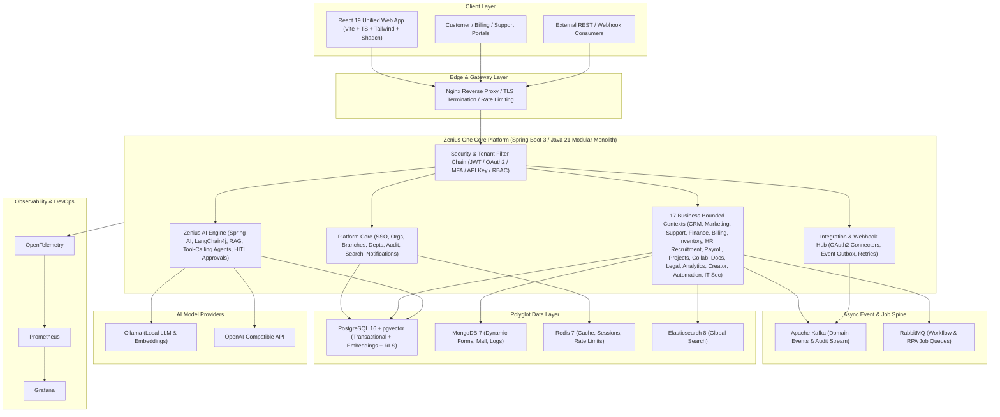

# Zenius One — Complete System Architecture

**Product:** Zenius One  
**Category:** Unified Enterprise Business Operating System with AI (Zoho One-Inspired)  
**Architecture Style:** Domain-Driven Modular Monolith (Spring Boot 3.4+ / Java 21+) designed for zero-friction microservice extraction, paired with a unified React 19+ TypeScript micro-shell frontend.

---

## 1. Architectural Principles

1. **Unified Identity, Isolated Tenant Data:** Single Sign-On (SSO) across all 20 business applications with strict `organization_id` tenant isolation enforced at the security filter, Hibernate/JPA filter, PostgreSQL Row-Level Security (RLS), and AI RAG vector query layers.
2. **Modular Monolith First (Extractable Bounded Contexts):** Each of the 20 bounded contexts lives in its own isolated Java package (`com.zenius.one.modules.<context>`) with private repositories/entities and communicates across boundaries exclusively via public domain service interfaces or asynchronous domain events (Spring ApplicationEvent / Apache Kafka).
3. **Polyglot Persistence:**
   - **PostgreSQL 16 + pgvector:** System of record for transactional relational data (CRM, Accounting, Payroll, HR, Inventory, RBAC, Subscriptions) and vector embeddings for RAG.
   - **MongoDB 7:** Flexible schema storage for Low-Code Creator forms/records, Email bodies, Audit event payloads, Analytics dashboard definitions, and Document metadata.
   - **Redis 7:** Distributed session/token blocklists, rate-limiting buckets, permission caches, and real-time presence/chat pub-sub.
   - **Elasticsearch 8:** Full-text global search across leads, contacts, tickets, emails, invoices, documents, and knowledge base articles.
4. **Event-Driven & Automation Spine:** Apache Kafka for high-throughput domain events (`crm.lead.created`, `finance.invoice.overdue`, `support.ticket.escalated`) and RabbitMQ for delayed/retryable workflow and RPA job queues.
5. **AI-Native Core (Zenius AI):** Spring AI + LangChain4j orchestrating Ollama (local) and OpenAI-compatible endpoints, grounded via pgvector RAG and governed by explicit RBAC + Human-in-the-Loop (HITL) approval gates for mutating tool calls.

---

## 2. High-Level System Topology

---

## 3. Cross-Cutting Infrastructure

| Concern | Technology | Implementation Pattern |
|---|---|---|
| API Contract | OpenAPI 3.1 (`springdoc-openapi`) | Versioned REST `/api/v1/{module}/...` with `ApiResponse<T>` envelope & RFC 7807 `ProblemDetail` errors |
| Real-Time Updates | WebSocket (STOMP) + SSE | Notifications, live chat, AI token streaming, workflow execution status |
| Batch & Scheduled Jobs | Spring Batch + ShedLock | Payroll runs, recurring invoices, depreciation, dunning retries, report scheduling |
| Database Migrations | Flyway | Versioned SQL migrations under `db/migration/V{n}__{desc}.sql`, strict schema ownership per module |
| Observability | Micrometer + OpenTelemetry + Prometheus + Grafana | Trace IDs propagated through HTTP headers, Kafka headers, and structured JSON logs |
| Security Controls | Spring Security 6, Argon2/BCrypt, JWT RS256, TOTP MFA, Bucket4j | OWASP ASVS controls, CORS allowlists, idempotency keys, immutable audit logs |

