# Zenius One — Enterprise Database ER Diagram

All core multi-tenant entities include `id (UUID)`, `organization_id (UUID)`, `created_at`, `updated_at`, `created_by`, `updated_by`, `version (optimistic lock)`, and `deleted_at (soft delete)` where applicable.

```mermaid
erDiagram
    ORGANIZATIONS ||--o{ BRANCHES : "has"
    ORGANIZATIONS ||--o{ DEPARTMENTS : "has"
    ORGANIZATIONS ||--o{ ORG_MEMBERSHIPS : "contains"
    USERS ||--o{ ORG_MEMBERSHIPS : "belongs_to"
    ORG_MEMBERSHIPS ||--o{ MEMBER_ROLES : "assigned"
    ROLES ||--o{ MEMBER_ROLES : "granted_via"
    ROLES ||--o{ ROLE_PERMISSIONS : "includes"
    PERMISSIONS ||--o{ ROLE_PERMISSIONS : "mapped_to"

    ORGANIZATIONS ||--o{ SUBSCRIPTIONS : "subscribes"
    SUBSCRIPTION_PLANS ||--o{ SUBSCRIPTIONS : "defines"

    ORGANIZATIONS ||--o{ CRM_ACCOUNTS : "owns"
    CRM_ACCOUNTS ||--o{ CRM_CONTACTS : "employs"
    ORGANIZATIONS ||--o{ CRM_LEADS : "tracks"
    CRM_LEADS }o--o| CRM_ACCOUNTS : "converts_to"
    CRM_ACCOUNTS ||--o{ CRM_DEALS : "has"
    CRM_PIPELINES ||--o{ CRM_STAGES : "contains"
    CRM_STAGES ||--o{ CRM_DEALS : "categorizes"

    CRM_ACCOUNTS ||--o{ INVOICES : "billed_via"
    INVOICES ||--o{ INVOICE_LINES : "contains"
    JOURNAL_ENTRIES ||--o{ JOURNAL_LINES : "posts"
    CHART_OF_ACCOUNTS ||--o{ JOURNAL_LINES : "classifies"
    INVOICES ||--o{ PAYMENTS : "settled_by"

    PRODUCTS ||--o{ STOCK_LEVELS : "stocked_in"
    WAREHOUSES ||--o{ STOCK_LEVELS : "stores"
    SALES_ORDERS ||--o{ SALES_ORDER_LINES : "items"
    PRODUCTS ||--o{ SALES_ORDER_LINES : "ordered_in"

    ORG_MEMBERSHIPS ||--o| EMPLOYEES : "links"
    DEPARTMENTS ||--o{ EMPLOYEES : "groups"
    EMPLOYEES ||--o{ ATTENDANCE_RECORDS : "logs"
    EMPLOYEES ||--o{ LEAVE_REQUESTS : "submits"
    EMPLOYEES ||--o{ PAYSLIPS : "receives"
    JOB_OPENINGS ||--o{ CANDIDATES : "receives"

    ORGANIZATIONS ||--o{ PROJECTS : "runs"
    PROJECTS ||--o{ PROJECT_TASKS : "breaks_into"
    EMPLOYEES ||--o{ PROJECT_TASKS : "assigned_to"

    ORGANIZATIONS ||--o{ SUPPORT_TICKETS : "handles"
    CRM_CONTACTS ||--o{ SUPPORT_TICKETS : "opens"

    ORGANIZATIONS ||--o{ KNOWLEDGE_DOCUMENTS : "indexes"
    KNOWLEDGE_DOCUMENTS ||--o{ DOCUMENT_CHUNKS : "embedded_in_pgvector"
    ORGANIZATIONS ||--o{ WORKFLOW_DEFINITIONS : "automates"
    WORKFLOW_DEFINITIONS ||--o{ WORKFLOW_EXECUTIONS : "runs"
    ORGANIZATIONS ||--o{ AUDIT_LOGS : "records"

    ORGANIZATIONS {
        uuid id PK
        string slug UK
        string name
        string currency
        string timezone
        string status
    }
    USERS {
        uuid id PK
        string email UK
        string password_hash
        string full_name
        boolean mfa_enabled
        string status
    }
    ORG_MEMBERSHIPS {
        uuid id PK
        uuid organization_id FK
        uuid user_id FK
        uuid branch_id FK
        uuid department_id FK
        string status
    }
    ROLES {
        uuid id PK
        uuid organization_id FK
        string code
        string name
        boolean is_system
    }
    PERMISSIONS {
        uuid id PK
        string module_code
        string permission_key UK
    }
    CRM_LEADS {
        uuid id PK
        uuid organization_id FK
        string full_name
        string email
        string company_name
        int lead_score
        string status
        uuid owner_id FK
    }
    CRM_DEALS {
        uuid id PK
        uuid organization_id FK
        uuid account_id FK
        uuid stage_id FK
        decimal amount
        int probability
        date expected_close_date
    }
    INVOICES {
        uuid id PK
        uuid organization_id FK
        uuid account_id FK
        string invoice_number
        string currency
        decimal total_amount
        string status
        date due_date
    }
    EMPLOYEES {
        uuid id PK
        uuid organization_id FK
        uuid membership_id FK
        string employee_code
        string designation
        date joining_date
    }
    DOCUMENT_CHUNKS {
        uuid id PK
        uuid organization_id FK
        uuid document_id FK
        text content
        vector embedding
        jsonb metadata
    }
```

## Phase 1 Implemented Schema (`V1__init_platform_foundation.sql`)
- Extensions: `uuid-ossp`, `pgcrypto`, `vector` (when pgvector is available; graceful baseline)
- `platform_modules`: Registry of all 20 Zenius One applications, phase, category, route, icon, status, and capabilities.
- `system_settings`: Global platform configuration baseline key-value store.

